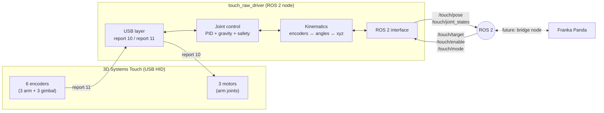

# Haptic Teleoperation: 3D Systems Touch ↔ ROS 2 ↔ Franka Panda


Bilateral haptic teleoperation between a **3D Systems Touch** haptic device and a
**Franka Emika Panda** robot, with **ROS 2** at the centre of the architecture.
The final goal is a teleoperated pick-and-place task with haptic feedback.

Special assignment (10 ECTS) at **Aalto University**, supervised by Prof. Shankar Deka.

> **Highlight.** On Ubuntu 24.04 the vendor's Linux library reads the device correctly
> but always sends **zero current** to the motors. By capturing the USB traffic I located
> the problem, decoded the device's USB protocol and wrote a **ROS 2 driver that commands
> the motors directly over USB**, with its own kinematic model, gravity compensation and
> safety layer. See [Deliverable 2](docs/02_deliverable2_motor_control.md).

<!-- Add a photo or GIF of the Touch moving to a ROS 2 target here, e.g.:
 -->

---

## Project status

| Milestone | Description | Status |
|---|---|---|
| Deliverable 1 | Read the Touch pose in ROS 2 | ✅ Done |
| Deliverable 2 | Command the Touch from ROS 2 (move the stylus to a published target) | ✅ Done |
| Gravity compensation | Arm holds itself up (partial, motor thermal limits) | 🔄 In progress |
| Stylus orientation | Full 6-DOF pose from the gimbal encoders | ⏳ Planned |
| Franka bridge | Touch ↔ Franka mapping (position, then force feedback) | ⏳ Planned |
| Pick and place | Teleoperated task with haptic feedback | ⏳ Planned |

Detailed history: [CHANGELOG.md](CHANGELOG.md).

---

## Architecture



The Touch measures 6 degrees of freedom but actuates only 3: the motors push the point
where the stylus is attached (x, y, z); the stylus orientation is only measured.

---

## Repository structure

```
haptic-teleoperation-touch-franka/
├── README.md                    ← this page
├── CHANGELOG.md                 ← milestones, updated as the project advances
├── LICENSE
├── docs/                        ← documentation
│   ├── 00_setup.md              ← system setup (Ubuntu, ROS 2, 3D Systems software)
│   ├── 01_deliverable1_pose_reading.md
│   ├── 02_deliverable2_motor_control.md
│   ├── usb_protocol.md          ← decoded USB protocol of the Touch
│   ├── calibration.md           ← kinematic and gravity calibration
│   ├── safety.md
│   ├── references.md            ← third-party code, papers, credits
│   ├── repository_workflow.md   ← how the repo is updated
│   └── media/                   ← photos and videos
├── ros2/
│   └── touch_raw_driver/        ← ROS 2 package (ament_python): the driver
├── third_party/
│   └── geomagic_touch_ros2/     ← how to get the Deliverable 1 driver + my patch
├── tools/
│   ├── usb/                     ← direct USB tests of the motors
│   ├── calibration/             ← kinematic and gravity calibration
│   └── monitoring/              ← helper scripts
├── calibration/                 ← calibration results of my device (JSON)
└── data/                        ← recorded data (USB captures, logs)
```

---

## Quick start

Tested on Ubuntu 24.04 with ROS 2 Jazzy. Full instructions: [docs/00_setup.md](docs/00_setup.md).

```bash
# 1. Dependencies
sudo apt install python3-usb python3-numpy

# 2. Clone into a ROS 2 workspace and build
mkdir -p ~/geomagic_ws/src && cd ~/geomagic_ws/src
git clone https://github.com/nicola-gaiotto/haptic-teleoperation-touch-franka.git
cd ~/geomagic_ws
colcon build --symlink-install --packages-select touch_raw_driver
source install/setup.bash

# 3. Calibration files (device specific, see docs/calibration.md)
mkdir -p ~/.touch_raw_driver
cp src/haptic-teleoperation-touch-franka/calibration/*.json ~/.touch_raw_driver/

# 4. Run the driver (stylus in the inkwell, nothing else using the Touch)
ros2 launch touch_raw_driver touch_raw_driver.launch.py
```

In a second terminal:

```bash
source ~/geomagic_ws/install/setup.bash
ros2 topic echo /touch/pose --field pose.position          # stylus position [m]
ros2 topic pub --once -w 1 /touch/enable std_msgs/msg/Bool "{data: true}"
ros2 topic pub --once -w 1 /touch/target geometry_msgs/msg/Point "{x: 0.05, y: 0.0, z: 0.0}"
ros2 topic pub --once -w 1 /touch/enable std_msgs/msg/Bool "{data: false}"   # hold the stylus: it drops
```

---

## ROS 2 interface of `touch_raw_driver`

Frame `touch_base`: x to the right, y forward (away from the operator), z up, metres,
origin near the centre of the workspace (same frame as `/phantom/pose` of Deliverable 1).

| Topic | Type | Direction | Content |
|---|---|---|---|
| `/touch/pose` | `geometry_msgs/PoseStamped` | out | stylus attachment point [m]; orientation not yet computed |
| `/touch/joint_states` | `sensor_msgs/JointState` | out | arm joint angles [rad] |
| `/touch/joint_counts` | `std_msgs/Int32MultiArray` | out | raw encoder counts, arm joints |
| `/touch/encoders` | `std_msgs/Int32MultiArray` | out | all 6 raw encoders |
| `/touch/motor_cmd` | `std_msgs/Int32MultiArray` | out | command sent to the 3 motors |
| `/touch/target` | `geometry_msgs/Point` | in | Cartesian target [m] |
| `/touch/joint_target` | `std_msgs/Int32MultiArray` | in | joint target [encoder counts] |
| `/touch/enable` | `std_msgs/Bool` | in | motors on / off (starts **off**) |
| `/touch/mode` | `std_msgs/String` | in | `position` (default) or `float` (gravity compensation only) |

Parameters: [ros2/touch_raw_driver/config/touch_raw_driver.yaml](ros2/touch_raw_driver/config/touch_raw_driver.yaml).

---

## Documentation

| Document | Content |
|---|---|
| [Setup](docs/00_setup.md) | Ubuntu 24.04, ROS 2 Jazzy, 3D Systems driver and OpenHaptics, udev, locale |
| [Deliverable 1](docs/01_deliverable1_pose_reading.md) | Reading the pose with the third-party driver; timer fix; frame verification |
| [Deliverable 2](docs/02_deliverable2_motor_control.md) | Diagnosis of the zero-force problem and the direct-USB driver |
| [USB protocol](docs/usb_protocol.md) | Reports, endpoints, encoders and motor commands |
| [Calibration](docs/calibration.md) | Kinematic model and gravity model |
| [Safety](docs/safety.md) | Limits, emergency stop, thermal protection |
| [References](docs/references.md) | Third-party code, papers and credits |
| [Repository workflow](docs/repository_workflow.md) | How the repository is updated as the project advances |

---

## Roadmap

1. Finish gravity compensation tuning.
2. Stylus orientation from the gimbal encoders → full 6-DOF pose.
3. Bridge node Touch ↔ Franka Panda (workspace scaling, frames), first with a simulated
   robot, then in the lab.
4. Force feedback: calibrate motor command ↔ newtons, render the Franka contact forces.
5. Teleoperated pick-and-place with haptic feedback.

---

## Credits and disclaimer

- Deliverable 1 uses the third-party driver
  [tstoyanov/Geomagic_Touch_ROS2](https://github.com/tstoyanov/Geomagic_Touch_ROS2);
  only my patch is included here. Full list of references: [docs/references.md](docs/references.md).
- 3D Systems OpenHaptics and the Touch Device Driver are proprietary and **not included**.
- The USB protocol was decoded on my own device for interoperability, by observing the
  traffic of the official software. It is **not official documentation**, may not apply
  to other devices or firmware versions, and is used at your own risk. This project is
  not affiliated with 3D Systems.

## Author

**Nicola Gaiotto** — M.Sc. Autonomous Systems and Intelligent Robots (EIT Digital,
University of Bologna → Aalto University).
GitHub: [nicola-gaiotto](https://github.com/nicola-gaiotto)
<!-- LinkedIn: add your profile link here -->
