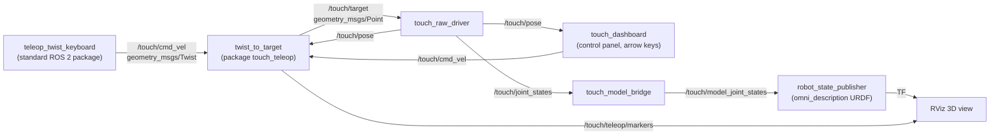

# Step 3 — Keyboard teleoperation of the Touch and GUI

**Goal (from the supervisor):** move the Touch *continuously* with the computer keyboard,
using the standard ROS 2 keyboard teleoperation, instead of publishing single x, y, z
targets. The same velocity interface will later be used to command the Franka.
Show the result in a GUI.

## Architecture



- `teleop_twist_keyboard` is **not** part of the driver: it is a standard ROS 2 node that
  turns key presses into velocity commands (`geometry_msgs/Twist`), the same message used
  by mobile robots and by many robot arms.
- `twist_to_target` (new package `touch_teleop`) integrates the velocity into a moving
  Cartesian target and sends it to `touch_raw_driver`. The driver is unchanged (only its
  log messages are throttled for continuous targets).
- Keeping the three nodes separate means that, for the Franka, only the last block
  changes: the same keyboard (or the Touch itself) will produce velocity commands for
  the robot.

## Key mapping

`teleop_twist_keyboard` uses letters, not the arrow keys:

| Key | Movement of the stylus |
|---|---|
| `i` / `,` | forward / backward (away from / towards you) |
| `j` / `l` | left / right |
| `t` / `b` | up / down |
| `u` `o` `m` `.` | diagonals (forward/backward combined with left/right) |
| `k` (or any other key) | **stop immediately** |
| `q` / `z` | all speeds +10 % / −10 % |
| `w` / `x` | linear speed only +10 % / −10 % |

Keep a key pressed for continuous motion. After releasing it the motion stops after
`cmd_timeout` (0.55 s), because the keyboard node only sends messages while a key is
pressed or auto-repeated. Press `k` to stop at once.

Default speed: 0.5 (teleop units) × `linear_scale` 0.05 = **2.5 cm/s** forward/backward and up/down; left/right uses the turn speed 1.0 × `angular_scale` 0.025 = **2.5 cm/s** as well.

## Safety limits of `twist_to_target`

| Parameter | Default | Meaning |
|---|---|---|
| `workspace_min` / `workspace_max` | (−0.08, −0.06, −0.05) / (0.08, 0.06, 0.08) m | the target never leaves this box |
| `max_lead` | 0.02 m | along the commanded axes, the target is never more than 2 cm ahead of the real stylus |
| `cmd_timeout` | 0.55 s | no key for this long → stop |
| `resync_distance` | 0.015 m | a new motion restarts from the real stylus position only if the old target is farther than this (stylus moved by hand, motors disabled) |

Two details avoid a downward drift when moving left/right: the lead limit acts only on
the commanded axes (a small sag on z does not drag the z target down), and after a pause
the target continues from where it was instead of restarting from the slightly sagged
stylus. The remaining vertical deviation while moving is a tracking error of the arm
(partial gravity compensation), reduced by tuning `gravity_gain` and `ki` of the driver.

Parameters: [ros2/touch_teleop/config/teleop.yaml](../ros2/touch_teleop/config/teleop.yaml).

## Tracking performance and tuning

Measured with `tools/analysis/teleop_tracking_report.py` (keyboard motions at ~2.5 cm/s):

| Configuration | Lag right | Lag left | Within 2 mm after release |
|---|---|---|---|
| initial gains (kp 0.5, gravity gain 0.7) | 0.31 s | 1.17 s | never |
| + friction and velocity feedforward, kp 0.8, gravity gain 0.85, max_delta 600 | 0.15 s | 0.08 s | immediately |

The breakaway friction of the joints, measured with
`tools/calibration/friction_identification.py`, is large (about 170-190 command units,
comparable to the gravity load): without compensation the joints stay still until the
integral term builds it up, which caused the delay and the left/right asymmetry. 50 % of
the measured friction is compensated.

Remaining limit: high in the workspace the second link needs more than the 600 command
limit to hold the arm, so the top of the teleoperation workspace was lowered to z = 5 cm.

## Running it

```bash
# Terminal 1: driver + velocity bridge + control panel + 3D view
ros2 launch touch_teleop teleop.launch.py

# Terminal 2: enable the motors (stylus held at mid-workspace)
ros2 topic pub --once -w 1 /touch/enable std_msgs/msg/Bool "{data: true}"

# Terminal 3: keyboard (this window must have the focus while you type)
ros2 run teleop_twist_keyboard teleop_twist_keyboard --ros-args -r cmd_vel:=/touch/cmd_vel
```

Instead of the keyboard terminal, the control panel can be used with the **arrow keys**
(see below).

## GUI

| Tool | What it shows | Command |
|---|---|---|
| **RViz 3D view** | the **3D model of the Touch** moving like the real one, seen from the operator, with the teleop target (orange sphere) and the workspace (light blue box) | started by the launch file (`rviz:=false` to skip) |
| **Control panel** (`touch_dashboard`) | stylus position in mm; buttons motors ON/OFF, position/float, STOP; speed; **arrow keys** (left/right, forward/back) and W/S (up/down): the motion lasts exactly while the key is held | started by the launch file (`dashboard:=false` to skip) |

### 3D model

The model is the URDF of the package `omni_description` (from the Deliverable 1 driver,
not copied here). `touch_model_bridge` converts the driver's joint angles into the model
joints with the same formulas as the Deliverable 1 driver, plus one correction: the URDF
elbow origin is rotated by −1.5 rad instead of −π/2, which places the stylus up to 1 cm
off; with the offset `π/2 − 1.5` and the base transform
`touch_base → touch/base` = (0, 0.1684, −0.1028) m, yaw 180°, the model matches the
measured kinematics within 1 mm. The model frames have the prefix `touch/`, so they will
not clash with the Franka's frames in the same scene (the RViz RobotModel display uses
`TF Prefix: touch`). The meshes of `omni_description` have no colours: the launch file adds
one colour per link when it processes the URDF (base dark grey, arms blue, stylus dark).
They also have missing or inconsistent normals, which RViz renders black: the launch file
writes copies with recomputed outward normals to `~/.touch_raw_driver/meshes/` and uses
those (the original files are not modified).

The stylus orientation in the model comes from the gimbal sensors (enc3..enc5), assuming
that the raw USB values equal the OpenHaptics ones (to be verified).
| **rqt_graph** | the nodes and topics of the system (good for explaining the architecture) | `ros2 run rqt_graph rqt_graph` |
| **rqt_plot** | stylus position over time | `ros2 run rqt_plot rqt_plot /touch/pose/pose/position/x /touch/pose/pose/position/y /touch/pose/pose/position/z` |

RViz uses a fixed frame `world`; the launch file publishes `world → touch_base`, so the
Franka can later be added to the same scene.
