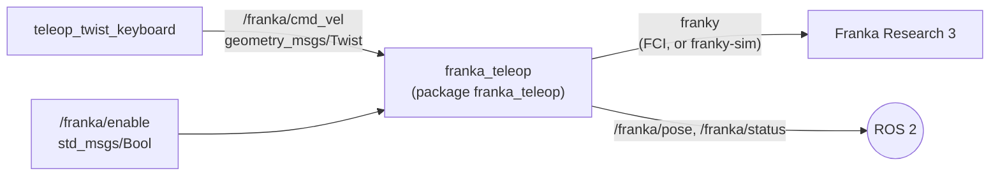

# Step 4 — Keyboard teleoperation of the Franka Research 3 (franky)

**Goal (from the tutor):** publish a ROS 2 node that teleoperates the lab's Franka Research 3,
using the [franky](https://github.com/TimSchneider42/franky) library.

**Status:** tested in simulation (franky-sim) with ROS 2 Jazzy, November 2026.
Not yet tested on the real robot.

## Architecture



franky talks to the robot directly through the Franka Control Interface (FCI) and does not
use ROS. `franka_teleop` is the bridge: it receives velocity commands from ROS 2 and turns
each one into a short franky `CartesianVelocityMotion`.

## Commanding principle

Every 50 ms (rate 20 Hz), while commands arrive, the node starts a velocity motion that is
held for 150 ms and replaces the previous one (`robot.move(..., asynchronous=True)`).
When commands stop, no new motion is started and the robot decelerates to zero by itself.
Only the linear velocity is commanded; the orientation of the end effector stays fixed.

Measured in franky-sim (2 cm/s along x for 2 s, then no more commands): smooth motion,
x velocity from 2 cm/s to 0 within about 0.2 s after the last command.

## Safety layer

| Measure | Default |
|---|---|
| Node starts disabled; motion only after `true` on `/franka/enable` | — |
| Speed limit on the end effector | 2 cm/s |
| franky relative dynamics factor | 5 % |
| Workspace box around the pose at enable time (outward motion blocked) | ±10 cm |
| Command timeout (must exceed the keyboard auto-repeat delay) | 0.55 s |
| Collision thresholds | 20 Nm, 30 N (franky defaults) |
| Any robot error disables the node; recovery only via `/franka/recover` | — |

On the real robot, in addition: brakes unlocked and FCI activated in Desk, a person
holding the emergency stop, area around the robot clear.

## Key mapping

Robot base frame (`fr3_link0`): x forward, y left, z up — the same convention as
`geometry_msgs/Twist`, so the keys map directly.

| Key | Motion |
|---|---|
| `i` / `,` | forward / backward (x) |
| `j` / `l` | left / right (y, from `angular.z`) |
| `t` / `b` | up / down (z) |
| `k` | stop |

## Installation

franky is installed with pip in a virtual environment that also sees the ROS 2 packages
(`python3.12-venv` must be installed):

```bash
python3 -m venv --system-site-packages ~/franky_venv
source ~/franky_venv/bin/activate
pip install franky-control franky-sim
```

The package must be built **with the venv active, through its Python**; otherwise the node
runs with the system Python and fails with `ModuleNotFoundError: No module named 'franky'`:

```bash
cd ~/geomagic_ws
python3 -m colcon build --symlink-install --packages-select franka_teleop
```

On the real robot franky additionally needs a real-time kernel (`PREEMPT_RT`), the
`realtime` user group and the wheel that matches the robot server version (see the franky
installation guide).

## Running in simulation

```bash
# Terminal 1
source ~/franky_venv/bin/activate
source /opt/ros/jazzy/setup.bash && source ~/geomagic_ws/install/setup.bash
ros2 launch franka_teleop franka_teleop.launch.py simulate:=true

# Terminal 2
source ~/geomagic_ws/install/setup.bash
ros2 topic pub --once -w 1 /franka/enable std_msgs/msg/Bool "{data: true}"
ros2 run teleop_twist_keyboard teleop_twist_keyboard --ros-args -r cmd_vel:=/franka/cmd_vel
```

## Results (simulation, 2026-11-01)

- franky 2.0.0 and franky-sim 1.0.4 on Ubuntu 24.04, ROS 2 Jazzy (numpy 2 inside the venv
  caused no problem).
- The simulated FR3 moves in the direction of each key and stops when the key is released.
- Scripted check of the node logic against franky-sim (10 cm/s requested upwards for 8 s):
  speed limited to 2 cm/s, stop at the workspace box limit (+10.1 cm).

## Next steps

1. Real robot: read-only connection, 2 cm relative move, velocity along each axis, then
   `franka_teleop` with the keyboard — always with the tutor present.
2. Touch → Franka in position (scaling, frames, clutch), first in simulation.
