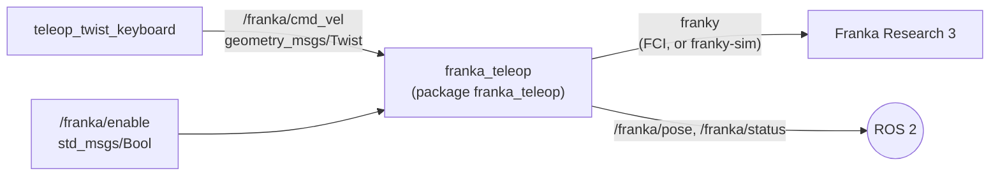

# Step 4 — Keyboard teleoperation of the Franka Research 3 (franky)

**Goal (from the tutor):** publish a ROS 2 node that teleoperates the lab's Franka Research 3,
using the [franky](https://github.com/TimSchneider42/franky) library.

**Status:** working on the real FR3 in the lab (2026-11-02), keyboard teleoperation from the
ready pose (`go_home`); first developed and tested in simulation (franky-sim, ROS 2 Jazzy).

## Architecture



franky talks to the robot directly through the Franka Control Interface (FCI) and does not
use ROS. `franka_teleop` is the bridge: it receives velocity commands from ROS 2 and turns
each one into a short franky `CartesianVelocityMotion`.

## Commanding principle

Every 50 ms (rate 20 Hz), while commands arrive, the node starts a velocity motion that is
held for 150 ms and replaces the previous one (`robot.move(..., asynchronous=True)`).
When commands stop, no new motion is started and the robot decelerates to zero by itself.
Only the linear velocity is commanded; the orientation of the end effector stays fixed.

Measured in franky-sim (2 cm/s along x for 2 s, then no more commands): smooth motion,
x velocity from 2 cm/s to 0 within about 0.2 s after the last command.

## Safety layer

| Measure | Default |
|---|---|
| Node starts disabled; motion only after `true` on `/franka/enable` | — |
| Speed limit on the end effector | 2 cm/s |
| franky relative dynamics factor | 5 % |
| Workspace box around the pose at enable time (outward motion blocked) | ±10 cm |
| Command timeout (must exceed the keyboard auto-repeat delay) | 0.55 s |
| Collision thresholds | 20 Nm, 30 N (franky defaults) |
| Any robot error disables the node; recovery only via `/franka/recover` | — |

On the real robot, in addition: brakes unlocked and FCI activated in Desk, a person
holding the emergency stop, area around the robot clear.

## Key mapping

The keys follow the operator's point of view (Twist read in the operator frame: x forward =
away from the operator, y left, z up) and are rotated about z by `operator_yaw_deg` into the
robot base frame (`fr3_link0`).

Measured in the lab (2026-11-02) with 1 cm velocity moves along each base axis, from the
operator's position: base +x = operator's right, base +y = away from the operator, so
`operator_yaw_deg = 90`. This is the same orientation as the Touch frame `touch_base`
(x right, y forward, z up).

| Key | Motion (operator's view) | Base axis (yaw 90°) |
|---|---|---|
| `i` / `,` | away / towards the operator | +y / −y |
| `j` / `l` | left / right | −x / +x |
| `t` / `b` | up / down | +z / −z |
| `k` | stop | — |

## Installation

franky is installed with pip in a virtual environment that also sees the ROS 2 packages
(`python3.12-venv` must be installed):

```bash
python3 -m venv --system-site-packages ~/franky_venv
source ~/franky_venv/bin/activate
pip install franky-control franky-sim
```

The package must be built **with the venv active, through its Python**; otherwise the node
runs with the system Python and fails with `ModuleNotFoundError: No module named 'franky'`:

```bash
cd ~/geomagic_ws
python3 -m colcon build --symlink-install --packages-select franka_teleop
```

On the real robot franky additionally needs a real-time kernel (`PREEMPT_RT`), the
`realtime` user group and the wheel that matches the robot server version (see the franky
installation guide).

## Running in simulation

```bash
# Terminal 1
source ~/franky_venv/bin/activate
source /opt/ros/jazzy/setup.bash && source ~/geomagic_ws/install/setup.bash
ros2 launch franka_teleop franka_teleop.launch.py simulate:=true

# Terminal 2
source ~/geomagic_ws/install/setup.bash
ros2 topic pub --once -w 1 /franka/enable std_msgs/msg/Bool "{data: true}"
ros2 run teleop_twist_keyboard teleop_twist_keyboard --ros-args -r cmd_vel:=/franka/cmd_vel
```

## Results on the real FR3 (lab, 2026-11-02)

Lab PC: kernel 6.8.0-rt8 (PREEMPT_RT), ROS 2 Humble, conda environment with Python 3.10 and
franky 1.1.1; robot at 172.16.0.2, joints unlocked, Execution mode, FCI on.

- Read-only connection: end effector at (0.627, −0.058, 0.266) m, gripper pointing down,
  no errors.
- Tutor's script (±10 cm relative along the end-effector x axis, 5 % dynamics): moved away
  from the operator and back.
- Velocity of 1 cm/s held 1 s along each base axis (`CartesianVelocityMotion`):

| Command | Measured displacement | Seen by the operator |
|---|---|---|
| +x | +0.94 cm in x | to the right |
| −x | −1.00 cm in x | to the left |
| +y | +0.99 cm in y | away |
| −y | −0.99 cm in y | towards |
| +z | +0.96 cm in z | up |
| −z | −0.99 cm in z | down |

- `franka_teleop` with the keyboard (operator_yaw_deg = 90): all key directions worked.
  After a while, at about +9.9 cm right (box limit), +9.2 cm up and 3.6 cm towards the
  operator from the start pose, the robot rejected the next command:
  `libfranka: Move command rejected: cannot start at singular pose!`. The node disabled
  itself as designed. State afterwards: end effector (0.726, −0.094, 0.358) m, joints
  [−0.443, 0.697, 0.504, −1.042, −0.262, 1.658, −0.864] rad, no robot errors.
  Hypothesis: the start pose was already far from the base (0.63 m) and the box allowed the
  arm to approach its extension limit. Countermeasure: optional `go_home` (slow joint motion
  to the Franka "ready" pose, end effector ≈ (0.31, 0.00, 0.49) m) before teleoperation.
- `go_home` on the real robot: ready pose reached in about 14 s, end effector at
  (0.307, 0.000, 0.487) m. Teleoperation from there with all keys, up to the box limits:
  all directions correct, no errors (operator's check).

### Running on the lab PC (ROS 2 Humble + conda)

franky is installed in the conda environment `franky_env` (Python 3.10, franky 1.1.1).
Build with the system colcon, run the node with the conda Python:

```bash
cd ~/franka_ws && source /opt/ros/humble/setup.bash
colcon build --symlink-install --packages-select franka_teleop
conda activate franky_env && source ~/franka_ws/install/setup.bash
python -m franka_teleop.franka_teleop_node --ros-args \
  --params-file ~/franka_ws/install/franka_teleop/share/franka_teleop/config/franka_teleop.yaml \
  -p robot_ip:=172.16.0.2 -p go_home:=true
```

## Results (simulation, 2026-11-01)

- franky 2.0.0 and franky-sim 1.0.4 on Ubuntu 24.04, ROS 2 Jazzy (numpy 2 inside the venv
  caused no problem).
- The simulated FR3 moves in the direction of each key and stops when the key is released.
- Scripted check of the node logic against franky-sim (10 cm/s requested upwards for 8 s):
  speed limited to 2 cm/s, stop at the workspace box limit (+10.1 cm).

## Next steps

1. Real robot: read-only connection, 2 cm relative move, velocity along each axis, then
   `franka_teleop` with the keyboard — always with the tutor present.
2. Touch → Franka in position (scaling, frames, clutch), first in simulation.
