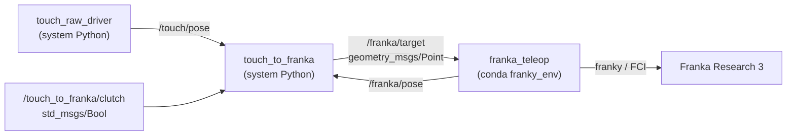
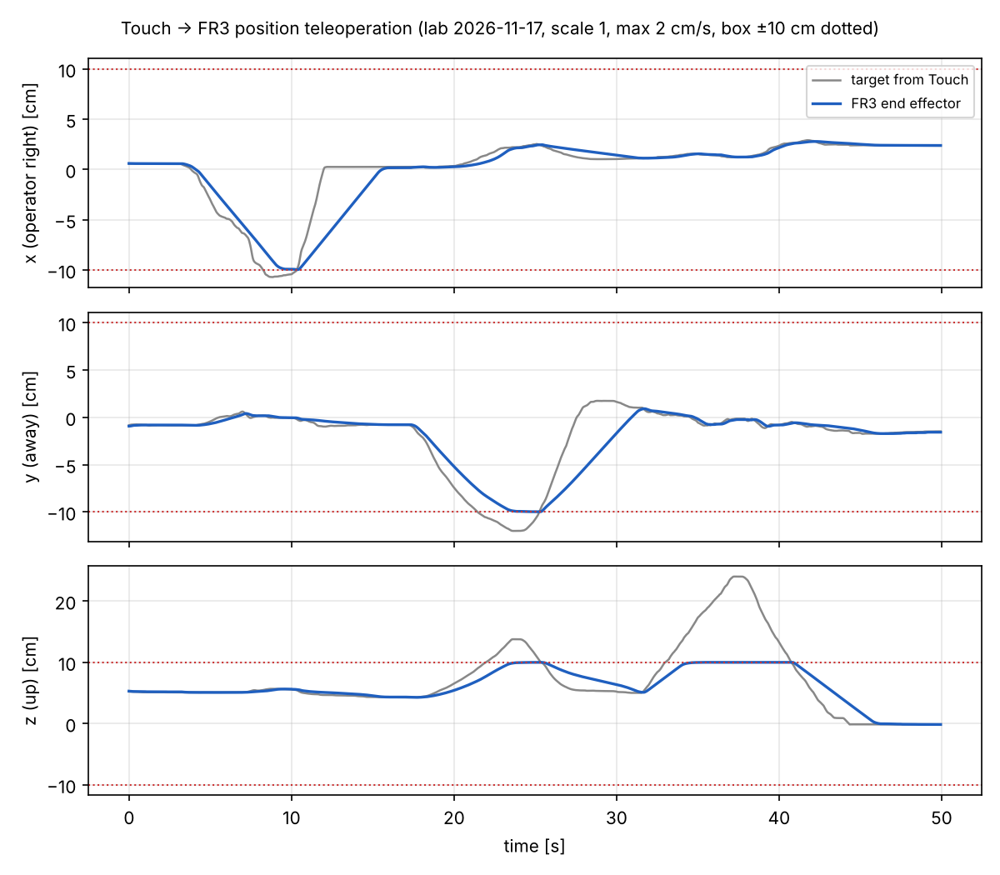
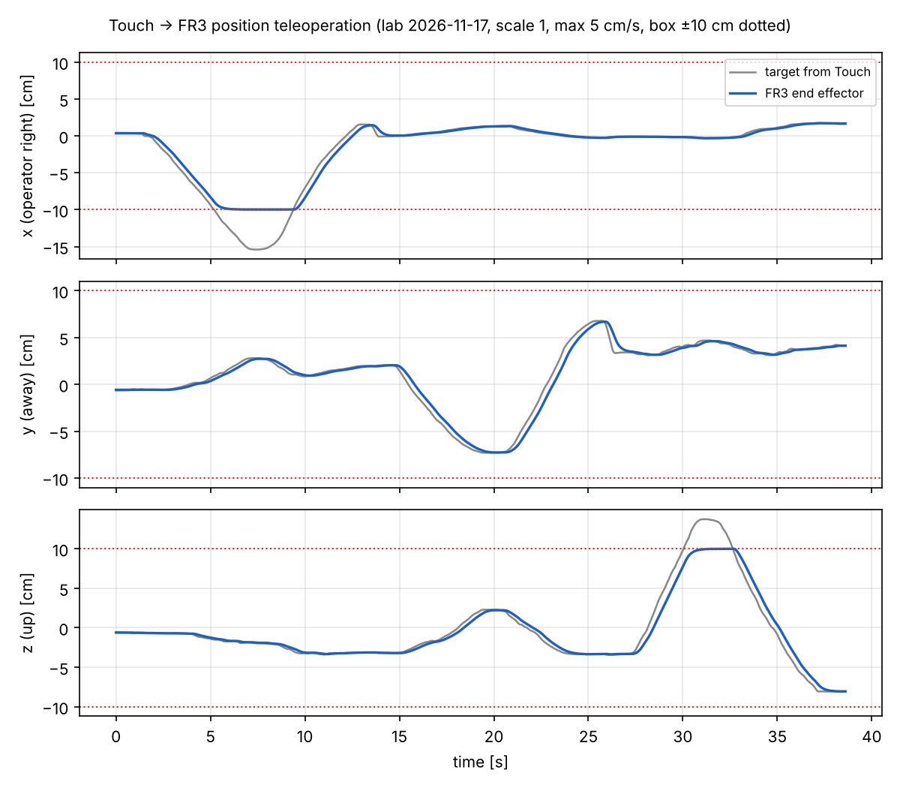

# Step 5 — Touch → Franka position teleoperation

**Goal (from the tutor, 2026-11-10):** connect the Touch to the lab system, check that the
driver and the keyboard teleoperation work there, then write a node that takes the values of
the Touch and turns them into Franka commands ("other way also" = force feedback, next step).

**Status:** working on the real FR3 in the lab (2026-11-17): the robot follows the stylus in
position (scale 1) with a clutch, inside the ±10 cm workspace box, up to 5 cm/s.

## Architecture



```
p_target = p_franka0 + scale * (p_touch - p_touch0)          (position only)
v_cmd    = position_gain * (clip_to_box(p_target) - p_franka)  then max_speed, box, timeout
```

- `p_touch0`, `p_franka0` are stored when the clutch is engaged, so the robot never jumps.
  Releasing the clutch sends a zero velocity: the robot stops and the stylus can be moved.
- `touch_base` (x right, y forward, z up) has the same orientation as the FR3 base seen from
  the operator in the lab (measured on 2026-11-02), so no rotation is needed (`yaw_deg = 0`).
- All the safety limits of `franka_teleop` still apply (starts disabled, speed limit,
  ±10 cm box around the pose at enable time, 0.55 s command timeout, dynamics 5 %).

## Lab PC setup (one PC for the Touch and the robot)

Lab PC: ROS 2 Humble, PREEMPT_RT kernel `6.8.0-rt8`, franky 1.1.1 in the conda
environment `franky_env`. Steps done on 2026-11-10/17:

| Item | What was done |
|---|---|
| Touch seen by the PC | `lsusb` shows `2988:0304 3D Systems Haptic Device` |
| pyusb (driver dependency) | not installed; no sudo for the user, so installed for the user only: `/usr/bin/python3 -m pip install --user pyusb` (1.3.1). numpy 1.21.5 and `libusb-1.0` were already there |
| USB permissions | device was `crw-rw-r-- root root`, driver failed with `USBError: [Errno 13] Access denied`; the tutor added a udev rule for 2988:0304 |
| Calibration | copied from the repository: `mkdir -p ~/.touch_raw_driver && cp calibration/*.json ~/.touch_raw_driver/` |
| Build | system colcon, `colcon build --symlink-install --packages-select touch_raw_driver touch_teleop franka_teleop` |

Checks on the lab PC (2026-11-17): driver loads both models, `/touch/pose` at 99.99 Hz
(std 0.2 ms); keyboard teleoperation of the Touch (`teleop.launch.py` +
`teleop_twist_keyboard`) works as on the laptop.

Problems met and fixes:
- After adding a new file to an already built package, `colcon build --symlink-install`
  failed with `No such file or directory: .../touch_to_franka.yaml`. Fix: remove the old
  build of that package only, `rm -rf build/franka_teleop install/franka_teleop`, and build again.
- franky stopped with `RealtimeException: Running kernel does not have realtime capabilities`:
  the PC had booted the generic kernel. Fix: reboot and choose the `6.8.0-rt8` kernel
  (GRUB → Advanced options). Check with `uname -r` and `cat /sys/kernel/realtime` (`1`).
- Terminals open with the conda `base` environment active: `conda deactivate` in the terminals
  that use the system Python (Touch driver, `touch_to_franka`, `ros2` tools).

## Running in the lab

Each block in its own terminal.

```bash
# T1: Touch driver (system Python)
conda deactivate
source /opt/ros/humble/setup.bash && source ~/franka_ws/install/setup.bash
ros2 run touch_raw_driver touch_raw_driver

# T2: franka_teleop (conda Python, franky); goes to the ready pose, then stays disabled
source /opt/ros/humble/setup.bash
conda activate franky_env && source ~/franka_ws/install/setup.bash
python -m franka_teleop.franka_teleop_node --ros-args \
  --params-file ~/franka_ws/install/franka_teleop/share/franka_teleop/config/franka_teleop.yaml \
  -p robot_ip:=172.16.0.2 -p go_home:=true -p max_speed:=0.05

# T3: touch_to_franka (system Python)
conda deactivate
source /opt/ros/humble/setup.bash && source ~/franka_ws/install/setup.bash
ros2 run franka_teleop touch_to_franka --ros-args \
  --params-file ~/franka_ws/install/franka_teleop/share/franka_teleop/config/touch_to_franka.yaml

# T4: enable the robot, then engage the clutch with the stylus at the centre
ros2 topic pub --once -w 1 /franka/enable std_msgs/msg/Bool "{data: true}"
ros2 topic pub --once -w 1 /touch_to_franka/clutch std_msgs/msg/Bool "{data: true}"
# release the clutch / disable the robot:
ros2 topic pub --once -w 1 /touch_to_franka/clutch std_msgs/msg/Bool "{data: false}"
ros2 topic pub --once -w 1 /franka/enable std_msgs/msg/Bool "{data: false}"
```

## Results on the real FR3 (lab, 2026-11-17)

Procedure:
1. Dry run with the robot **disabled**: clutch engaged, `/franka/target` watched with
   `ros2 topic echo`. Stylus right / forward / up → target x / y / z increase (operator's check).
2. Robot enabled, scale 1, `max_speed` 2 cm/s, then 5 cm/s. The operator moved the stylus left
   and back, backward and back, up and back, partly beyond the box. Both runs recorded with
   `ros2 bag record` and analysed with
   [tools/analysis/touch_franka_bag_report.py](../tools/analysis/touch_franka_bag_report.py)
   (box centre = ready pose (0.307, 0.000, 0.487) m).

| | max 2 cm/s | max 5 cm/s |
|---|---|---|
| recording | 50.0 s | 38.6 s |
| topic rates (`/touch/pose`, `/franka/target`, `/franka/pose`) | 100 / 50 / 20 Hz | 100 / 50 / 20 Hz |
| offset target − stylus, std (x, y, z) | 0.07, 0.07, 0.10 mm | 0.09, 0.08, 0.12 mm |
| lag robot vs target (x, y, z) | 1.22, 1.52, 1.12 s | 0.33, 0.33, 0.35 s |
| error to the box-clipped target: mean / p95 / max | 16.2 / 60.1 / 70.7 mm | 8.1 / 17.4 / 21.9 mm |
| robot speed, max | 2.1 cm/s | 5.2 cm/s |
| stylus speed, 95th percentile | 5.7 cm/s | 6.0 cm/s |




Observations:
- Directions are correct on all three axes; the mapping is exact (constant offset, scale 1).
- The workspace box works: when the stylus goes further (x −15 cm, z +24 cm), the robot stops at
  ±10 cm from the ready pose and comes back with the stylus.
- With the stylus still, the robot settles within about 1 mm of the target (deadband 1 mm).
- At 2 cm/s the robot speed is saturated most of the time (stylus ~6 cm/s), hence the ~1.2–1.5 s
  lag. At 5 cm/s the lag drops to ~0.33 s and the mean error halves; the remaining lag comes
  from the speed limit and the proportional gain (3 1/s).
- `/franka/status` stayed `enabled` for both whole recordings: no robot errors.

## Next steps

1. Stylus buttons as clutch (now a topic) and for the gripper.
2. Force feedback Franka → Touch ("other way"): first virtual walls at the box limits on the
   Touch, then the external force estimated by the FR3, scaled, on the Touch.
