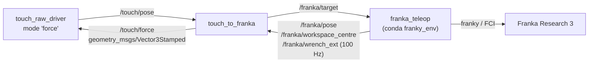
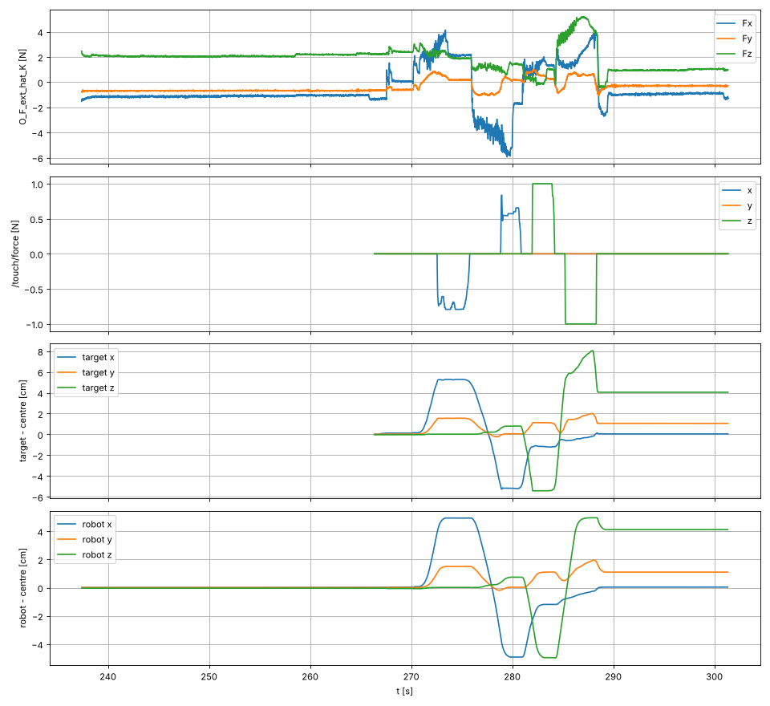
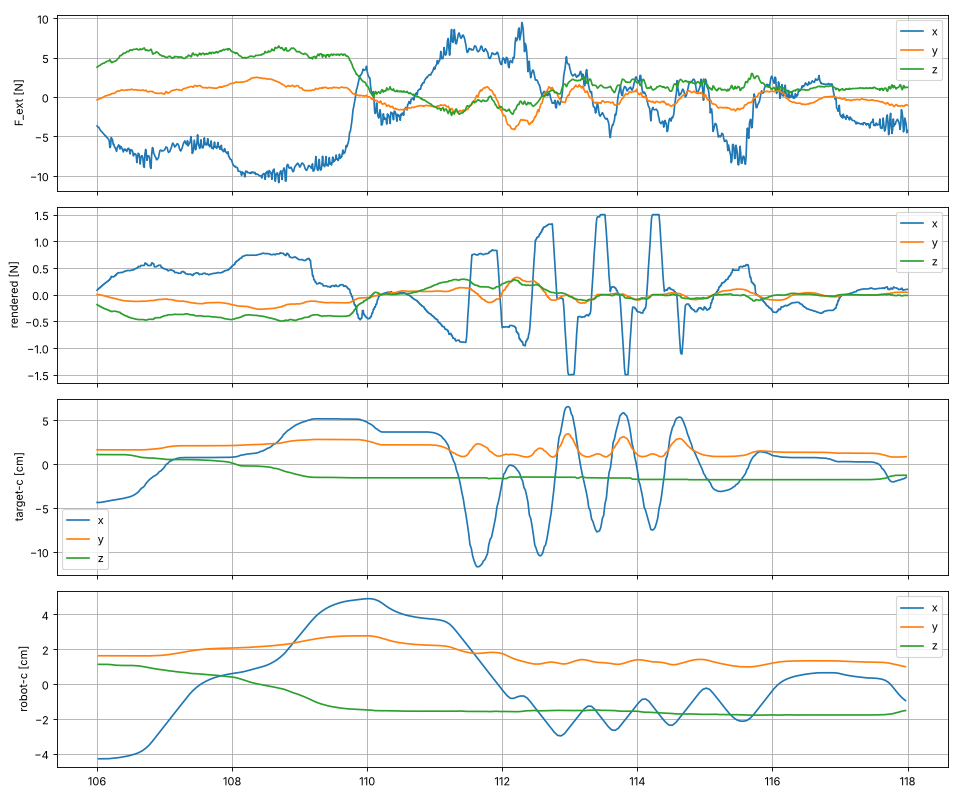
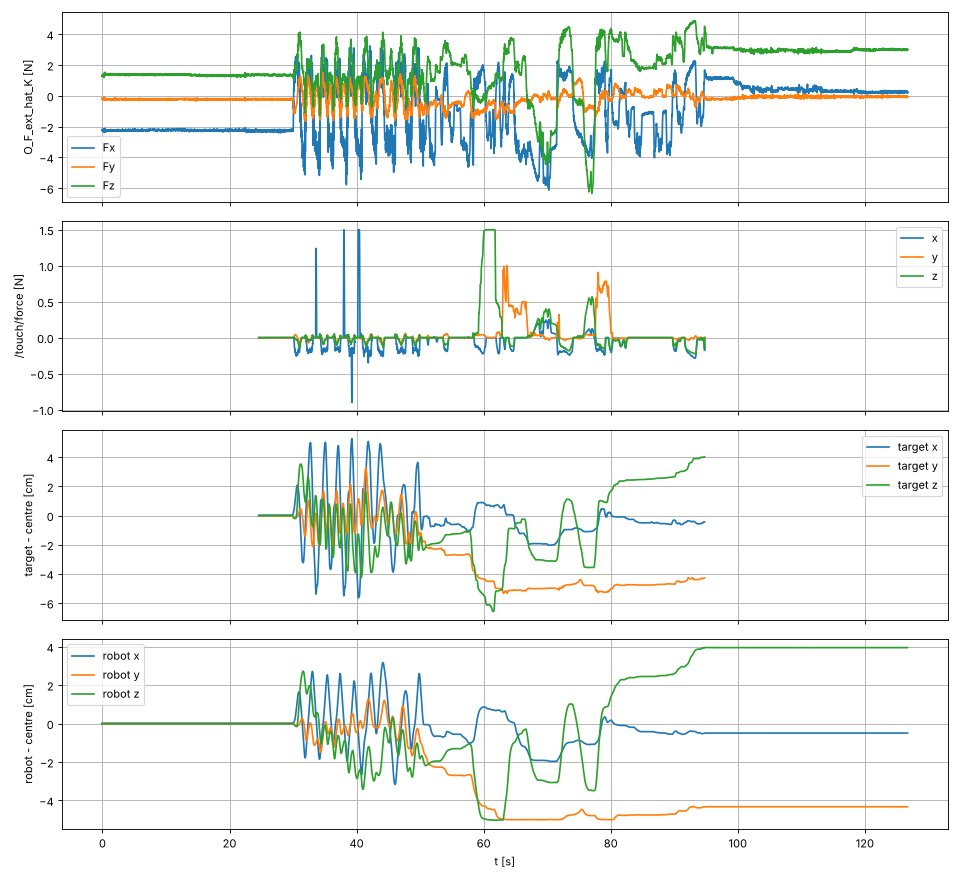
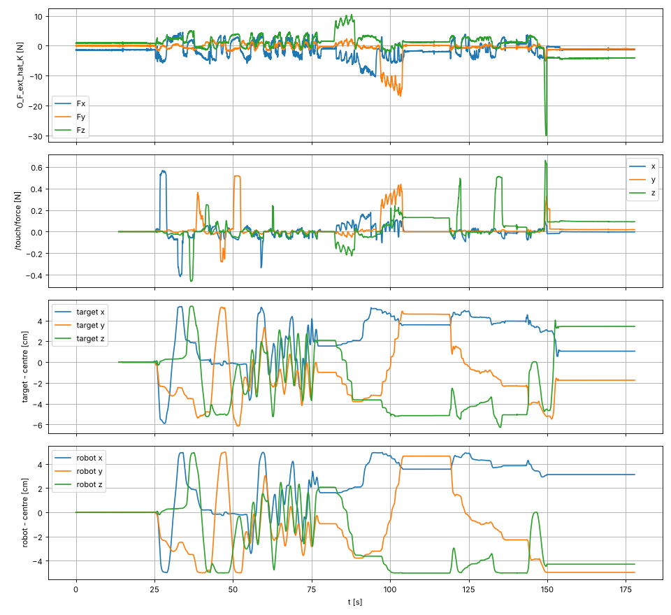
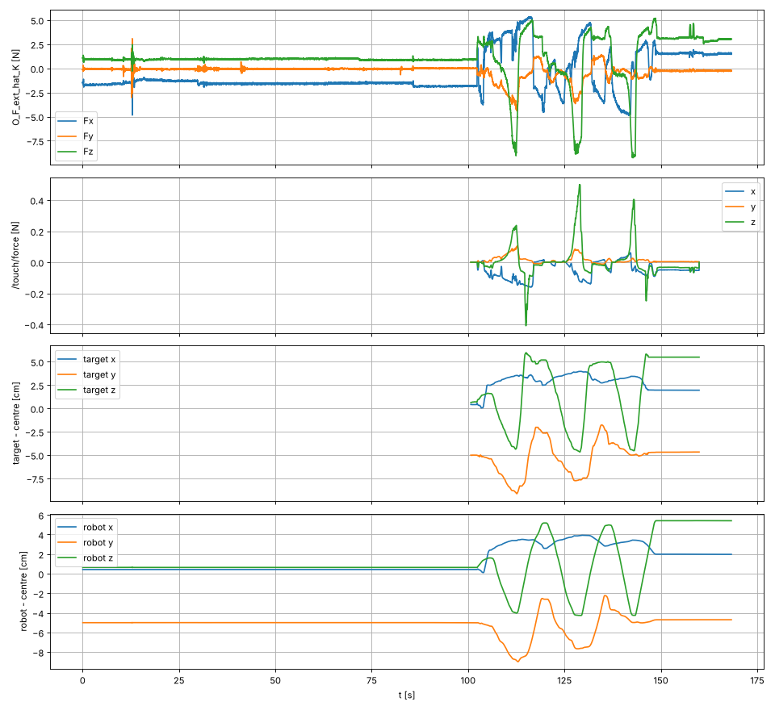
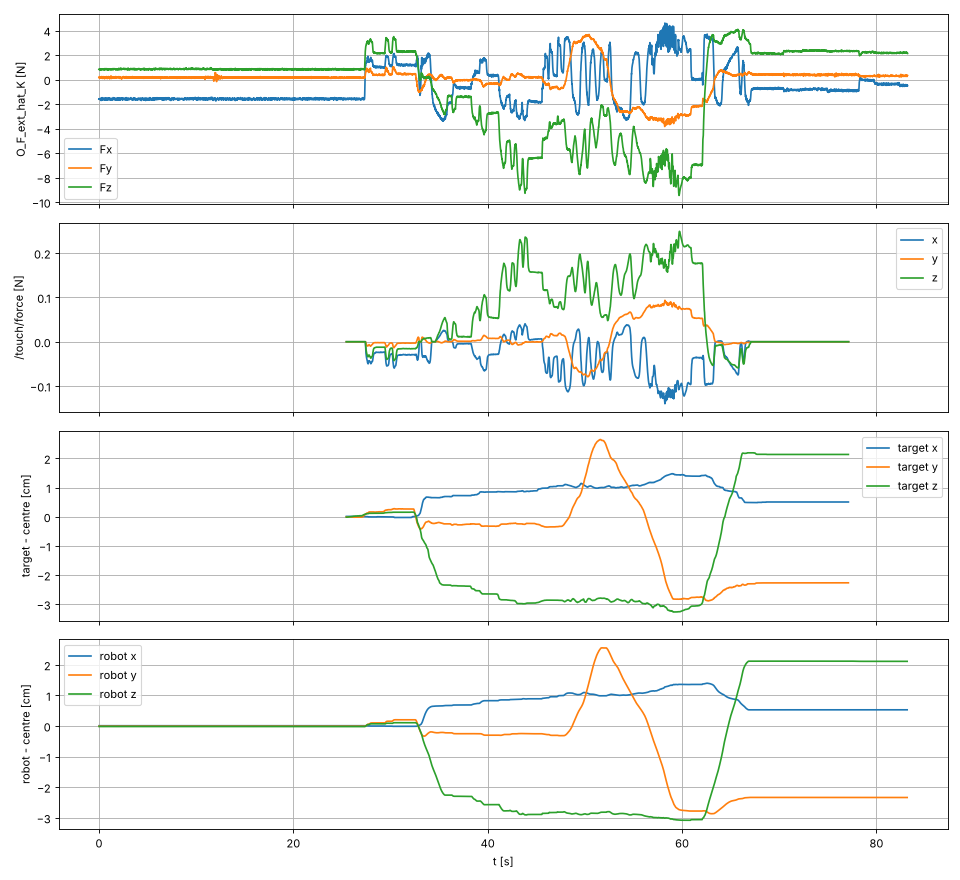

# Step 6 — Force feedback Franka → Touch

**Goal (from the tutor, 2026-11-10):** "other way also": the operator feels on the Touch what
happens at the robot.

**Status (lab, 2026-11-17 and 2026-11-19):** the Touch renders forces (new `force` mode of the
driver); virtual walls at the workspace box and the FR3 external force are felt on the stylus,
in the right direction, during Touch → FR3 teleoperation. The command → newton gain of the Touch
was calibrated afterwards (2026-11-20, [calibration.md §4](calibration.md#4-force-mode-motor-command--newton-force_gain)):
`force_gain` = 6780 instead of the estimated 2000, so **the Touch forces in the results below
(2026-11-17/19, gain 2000) are about 0.3 × the real ones**; the real maximum is about 0.7 N.

## Architecture



### Touch side: `force` mode of `touch_raw_driver`

`force` = `float` (gravity compensation) + a Cartesian force at the stylus tip:

```
tau_raw = J_raw(enc)^T F            J_raw = d p / d enc  [m/count], numerical, from the FK model
tau_i   = tau_raw_i / |dq_i/denc_i|  joint torque [N m]
cmd_i   = MOTOR_SIGN_i * force_gain_i * tau_i + gravity_i      then max_delta and thermal cap
```

| Parameter | Value used | Meaning |
|---|---|---|
| `force_gain` | 2000 (estimate) in the tests below; **6780 calibrated** (2026-11-20) | motor command per N m |
| `max_force` | 1.0 → 1.5 N | limit on the norm of the force (hard limit 3 N in code) |
| `force_timeout` | 0.1 s | no `/touch/force` → force back to zero |
| `force_slew_rate` | 20 N/s | maximum change of the rendered force |
| `force_damping` | 0 (17/11), 3 N s/m (19/11) | Cartesian damping `-b v` added to the force |

The rendered force is published on `/touch/force_rendered`. Pure math in
[`force.py`](../ros2/touch_raw_driver/touch_raw_driver/force.py), unit tests in
`ros2/touch_raw_driver/test/test_force.py` (the force direction always does positive work).

### Robot side: `franka_teleop`

Publishes `/franka/wrench_ext` (`geometry_msgs/WrenchStamped`, base frame) from franky's
`robot.state.O_F_ext_hat_K` at `wrench_rate` (100 Hz), and `/franka/workspace_centre` (centre
of the ±box, i.e. the pose at enable time).

### Bridge: `touch_to_franka`

- **Virtual walls** (`walls_enabled`): if the target leaves the box, `F = -wall_stiffness *
  excess` per axis, limited to `wall_max_force`. `fake_franka` uses a fixed Franka position
  (`wall_centre`), to test the walls with the Touch only.
- **Force feedback** (`force_feedback_enabled`):

  ```
  F_touch = ff_gain * deadzone( LPF( -(F_ext - F_ext_at_engage) ), ff_deadband )
  ```

  The minus sign comes from the measurement below (O_F_ext_hat_K is the force the robot
  applies to the environment). The bias is stored when the clutch is engaged (do not touch the
  robot then). `ff_gain`, `ff_deadband`, `ff_filter_alpha` can be changed at runtime.
- Walls + feedback are summed and limited to `max_force`. Unit tests in
  `ros2/franka_teleop/test/test_mapping.py`.

## Running in the lab

One terminal each; system-Python terminals start with
`conda deactivate` and `source /opt/ros/humble/setup.bash && source ~/franka_ws/install/setup.bash`.

```bash
# T1: Touch driver
ros2 run touch_raw_driver touch_raw_driver --ros-args \
  --params-file ~/franka_ws/install/touch_raw_driver/share/touch_raw_driver/config/touch_raw_driver.yaml \
  -p max_force:=1.5 -p force_damping:=3.0
# T2: Touch motors on, force mode
ros2 topic pub --once -w 1 /touch/enable std_msgs/msg/Bool "{data: true}"
ros2 topic pub --once -w 1 /touch/mode std_msgs/msg/String "{data: force}"
# T3 (source /opt/ros/humble/setup.bash; conda activate franky_env; source ~/franka_ws/install/setup.bash)
python -m franka_teleop.franka_teleop_node --ros-args \
  --params-file ~/franka_ws/install/franka_teleop/share/franka_teleop/config/franka_teleop.yaml \
  -p robot_ip:=172.16.0.2 -p go_home:=true -p max_speed:=0.05 -p "workspace_half_size:=[0.05, 0.05, 0.05]"
# T4: bridge with walls and force feedback
ros2 run franka_teleop touch_to_franka --ros-args \
  --params-file ~/franka_ws/install/franka_teleop/share/franka_teleop/config/touch_to_franka.yaml \
  -p walls_enabled:=true -p "wall_half_size:=[0.05, 0.05, 0.05]" \
  -p force_feedback_enabled:=true -p ff_gain:=0.1 -p ff_deadband:=2.0
# T5: after "Home reached", hands off the robot, stylus at the centre
ros2 topic pub --once -w 1 /franka/enable std_msgs/msg/Bool "{data: true}"
ros2 topic pub --once -w 1 /touch_to_franka/clutch std_msgs/msg/Bool "{data: true}"
```

The box is ±5 cm (instead of ±10 cm) so that the walls can be reached with the stylus
(Touch workspace about ±8 × ±6 × ±5 cm, scale 1).

## Results

All facts below were measured in the lab; hypotheses are marked.

### 1. FR3 external force (2026-11-17, robot idle)

| Condition | O_F_ext_hat_K force [N] |
|---|---|
| at rest (5 readings) | about (−0.9, 0.6, 0.6), variation about ±0.1 |
| end effector pushed down by hand | Fz from +3 up to +9 |

So `O_F_ext_hat_K` is the force the robot applies to the environment: the environment's force
on the robot is its opposite.

### 2. Touch force mode (2026-11-17, Touch only)

- 0.3 N constant force: hard to feel (below the joint friction, about 170–190 command units).
- 0.8 N, stylus left free: x → right, y → away from the operator, z → up. **All three
  directions correct.** Force back to zero after stopping `/touch/force`.

### 3. Virtual walls

- Touch only (`fake_franka`, walls at ±3 cm): with 100 N/m and 1 N the wall was felt only to the
  right/left; with **300 N/m and 1.5 N** it was felt in all directions.
- With the robot (box ±5 cm, 2026-11-17, bag `walls_1619`): the robot stops at ±5 cm in x and z
  exactly when the Touch pushes back (0.8 N in x, 1 N in z). The y walls were not reached.



### 4. Force feedback, pushing the robot by hand (2026-11-17, bag `ff_1626`)

`ff_gain` 0.1, dead zone 0.5 N, no Touch damping.
- Signs correct: e.g. Fy = −22 N on the robot → +1.5 N on the Touch, Fz = +25 N → −1.5 N.
- The operator felt the force in the right direction. Pushing up to 30 N in y triggered the FR3
  collision reflex (threshold 30 N); the robot then stopped (red LED).
- Without contact, the estimate changes with the robot pose: about −4 N in Fx at x = −5 cm and
  +3 N in Fz at z = +5 cm (bag `walls_1619`). With a 0.5 N dead zone this reaches the Touch as a
  "phantom" force.
- At 112–115 s the stylus moved back and forth in x (±6–10 cm, about 1 Hz) with the Touch force
  saturated at ±1.5 N. *Hypothesis:* closed loop force → stylus → robot with ~0.33 s lag, plus
  estimate errors during motion.



### 5. Free motion and contact with a rigid cube (2026-11-19, bag `contact_1737`)

`ff_gain` 0.1, **dead zone 2 N**, **Touch damping 3 N s/m**, box ±5 cm.
- Free motion (30–50 s): F_ext still changes by about ±5 N during fast motion, but the Touch
  force exceeds 0.5 N only 3 % of the time (when the target reaches the walls).
- Contact with a rigid cube under the gripper (~77 s): Fz down to −6.3 N (the cube pushes the
  robot up) → the Touch pushes up with about 0.6 N nominal (≈ 0.18 N real, uncalibrated gain).
  No collision reflex, no sustained oscillation; the operator judged the test good.



### 6. With the calibrated gain (2026-11-20, bags `calib_1538`, `contact3_1558`)

`force_gain` 6780, Touch `max_force` 0.7 N, damping 1 N s/m; walls 100 N/m / 0.5 N,
`ff_gain` 0.03, dead zone 2 N, total 0.7 N; box ±5 cm. All forces in real newtons.

- **Walls**: reached in all six directions (also forward/back); the robot stops at ±5 cm and
  the Touch pushes back with up to 0.5 N.
- **Free motion**: Touch force below 0.3 N.
- **Pushing the gripper by hand**: 10 N down → stylus pushed down (0.2 N); 16 N away from the
  operator → stylus pushed away (0.4 N). Directions correct.
- **Rigid contact** (rigid cube under the gripper, max speed 5 cm/s): at z = −4.3 cm the force
  rose from 1 to **30 N in 0.5 s** while the robot moved 2 mm (contact stiffness ≈ 13 kN/m);
  the FR3 collision reflex stopped the robot (red LED). The Touch pushed up with 0.66 N, its
  maximum: not enough to stop the operator's hand.



Since the Touch (≤ 0.7 N) cannot stop the hand, a **contact force limit** was added on the robot
side (`franka_teleop`, `contact_force_limit`): the force the environment applies to the end
effector, `−(O_F_ext_hat_K − value at enable)`, is computed every control tick; above the limit
the velocity component that pushes further into the contact is removed (moving away or sideways
is still allowed). Unit test in `test/test_limits.py`.

- **Contact with the limit** (same cube covered with a neck warmer, max speed 2 cm/s, limit
  10 N, three descents): contact force 9.8–10.2 N (above 10 N for 0.26 s in total, third
  descent only), robot 4.7–4.9 cm below the centre, i.e. also close to the box floor (−5 cm),
  which stopped the descent as well. Touch force up 0.24–0.5 N (feedback + floor wall).
  No collision reflex.



- **Contact limit alone** (bag `contact4_1616`, object raised so that the contact is at about
  −2.2 cm, well inside the box; same parameters): several contacts between 35 and 62 s with the
  robot at −2.2 to −3.1 cm. The contact force stayed at 6–10 N; it was above 10 N for 2.7 s in
  total (maximum 11.7 N), and during those intervals the robot stopped 1–2 mm above the target
  (e.g. 59.5–60.5 s: force 10.3–10.6 N, target −3.2 cm, robot −3.1 cm): the limit, not the box,
  held the robot. Sliding sideways in contact (y from +2.6 to −2.8 cm at about 9–10 N) was
  possible. Touch force up to 0.23 N. No collision reflex.



## Open points

- The F_ext estimate depends on the pose and on the motion (several newtons): a pose-dependent
  bias model, or a force sensor, would allow a smaller dead zone.
- Stability analysis with the 0.33 s lag (passivity / damping tuning); higher `ff_gain`.
