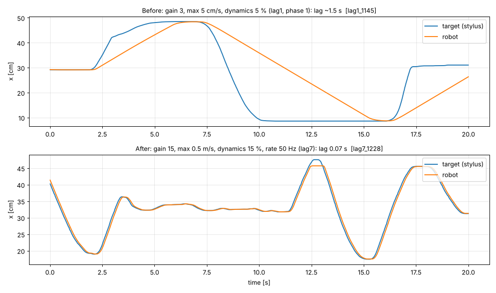

# Step 7 — Lower teleoperation lag, position-position coupling

**Feedback from the tutor and the professor (2026-11-24):** the Franka follows the Touch too
slowly (a problem for e.g. medical use); remove the workspace limitation; consider
position-position bilateral control (force on the Touch from the position error between Touch
and Franka; see Hokayem & Spong, "Bilateral teleoperation: An historical survey", Automatica
2006); the Touch force is too weak.

**Status (lab, 2026-11-24):** lag reduced from about 0.33 s (1.5 s on long moves with the old
5 cm/s cap) to **0.07 s**; position-position coupling works in free motion; contact with a
rigid object is not yet stable (see open points). The Touch peak command limit was raised from
600 to 1000; the sustained force is still limited by the thermal protection (see Results).

## Where the lag came from

All in our own `franka_teleop` parameters, chosen for the first safe tests:

| Parameter | Before | After (lag4/lag7) | Effect |
|---|---|---|---|
| `position_gain` | 3 1/s | 15 1/s | time constant 1/gain: 0.33 s → 0.07 s |
| `max_speed` | 0.02–0.05 m/s | 0.5 m/s | long moves were speed-limited |
| `dynamics_factor` | 0.05 | 0.15 | franky velocity/acceleration/jerk limits |
| `rate` | 20 Hz | 50 Hz | command rate |
| `state_rate` | 10–20 Hz | 100 Hz | `/franka/pose` rate (measurement, coupling) |
| `max_accel` (new) | – | 2 m/s² | ramp on the commanded velocity |

## Code changes

- `max_accel`: the commanded velocity changes by at most `max_accel / rate` per tick; applied
  after the workspace, floor and contact limits, so these do not create velocity steps either.
- `workspace_half_size`: an axis ≤ 0 is not limited; `min_height`: absolute floor in the base
  frame (negative = off).
- `control_mode: position` (optional): the target pose is sent to franky as an absolute
  `CartesianMotion` instead of the velocity loop. Tried once (lag6) in a near-singular pose,
  not validated.
- `touch_to_franka` position-position coupling (`pp_enabled`): Touch force
  `F = pp_stiffness * (p_robot - p_target)` mapped to the stylus, smooth dead zone
  `pp_deadband` (`mapping.coupling_force`). Needs `state_rate` 100.

Unit tests: `ros2/franka_teleop/test` (20 pass).

## Results

All facts below were measured in the lab (bags `lag1`–`lag9`, 2026-11-24); hypotheses are
marked. Lag = time shift that best aligns robot and target positions.

| Bag | Settings | Result |
|---|---|---|
| lag1, phase 1 | gain 3, 5 cm/s, dynamics 0.3, rate 50 | lag ≈ 1.5 s on ±20 cm moves (speed-limited) |
| lag1, phase 2 | gain 8, 0.2 m/s | lag 0.13 s; then reflex at 0.15 m/s, robot 7–10 cm from the base axis |
| lag2 | gain 8 / 15, dynamics 0.3 | lag 0.15 s / **0.08 s**, up to 0.39 m/s; ±0.02 m/s velocity ripple, audible |
| lag4 | gain 15, 0.5 m/s, dynamics 0.15, `max_accel` 2 | 90 s without reflex, **lag 0.07 s**, up to 0.47 m/s, mean error 2–14 mm |
| lag7 | as lag4, from home, box ±15/20/15 cm, coupling 30 N/m | 65 s without reflex, lag 0.07 s, mean error 6 mm; coupling force mean 0.02 N |

**libfranka reflex `cartesian_motion_generator_joint_velocity/acceleration_discontinuity`.**
It stopped the robot many times during the day. Measured circumstances:
- clutch left engaged from a previous run (target 8 cm from the robot at enable: lag2);
- a contact-limit warning in fast free motion (F_ext estimate 11–25 N without contact)
  followed within 0.4 s (twice, lag5) → fixed by applying the ramp last;
- the robot had drifted to x = 51.5 cm, z = 59.8 cm (arm nearly extended; the box is
  re-centred at every enable and was off): reflexes even at 0.04 m/s and at every restart
  (lag6, also in position mode).
After going home and restoring a box (±15 cm x, ±20 cm y, ±15 cm z) no reflex occurred
(lag7). *Hypothesis:* near-singular poses and velocity steps; the box is needed to keep away
from them, not for speed.

**Force estimate during fast motion.** Without contact, `O_F_ext_hat_K` reached 11–25 N
during fast motion (lag5): the F_ext-based force feedback (dead zone 2 N) then pushed the
released stylus and the loop oscillated; the 10 N contact limit fired without contact.
The F_ext-based feedback is therefore not usable at these speeds; the position-position
coupling does not use the estimate.

**Contact with the coupling** (lag8, lag9; bin on cardboard): with 30 N/m and a 1 cm dead
zone the Touch force was zero (stylus only 0.3–0.9 cm below the robot). With 80 N/m, 3 mm
dead zone: 0.1–0.26 N up on the Touch, free-motion force below 0.17 N. The contact force,
however, oscillated between about 10 and 22 N (limit 10 N, maximum 28 N, no reflex).
*Hypothesis:* on/off cycle: above the limit the robot stops and backs off, below
limit − 3 N it is released and moves in again at gain × error (≈ 7 cm/s), and on a rigid
object 1–2 mm are enough for 20 N.

**Touch force limit** (bag `tforce_1247`; driver `HARD_MAX_DELTA` 1000, `max_delta` 1000,
`rms_limit` 480; constant upward force steps of 0.7, 1.0 and 1.3 N on the stylus, held by hand).
Motor 3, which also carries most of the gravity compensation (about 320–350 command units with
no force), reached 984–1000 only during the first 1–2 s of each step. Then the RMS
thermal protection latched and capped it at 432 (= 0.9 × `rms_limit`) for the rest of each step,
for all three steps. So the 1.0 N and 1.3 N steps gave the same sustained command as the
0.7 N step. The operator felt the force but could not tell the steps apart. The peak limit is
therefore no longer the bottleneck. A stronger sustained force needs a higher `rms_limit`, which
must not be raised without the motor's continuous current rating (heating). *Not measured:*
the force in newtons above 600 units (calibration with the kitchen scale only up to 0.4 N).

## Open points

- Stable contact with rigid objects at high gain: impedance/admittance behaviour near
  contact instead of the on/off limit (literature: Hokayem & Spong 2006; Lawrence 1993).
- Touch force: the peak limit is now 1000 command units (≈ 1.1–1.2 N extrapolated, not
  measured). The sustained force is set by `rms_limit` (480). Find the motor's continuous
  rating before raising it, then check with the kitchen scale.
- Position control mode: test in a well-conditioned pose.
